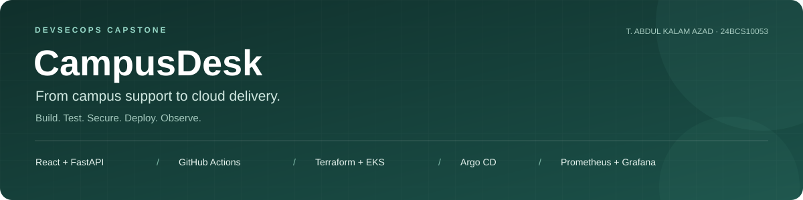
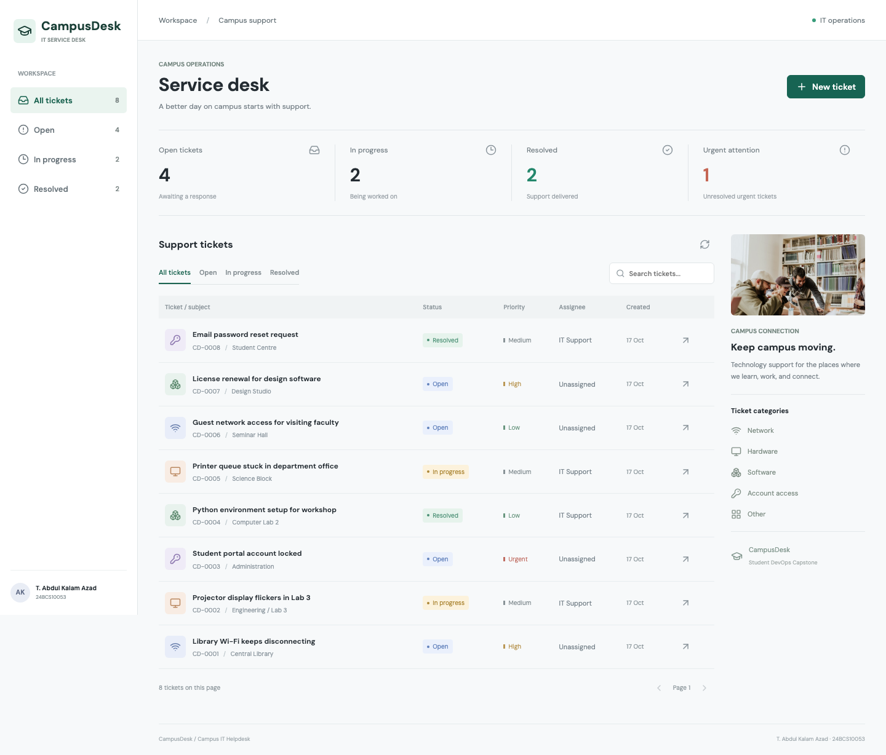
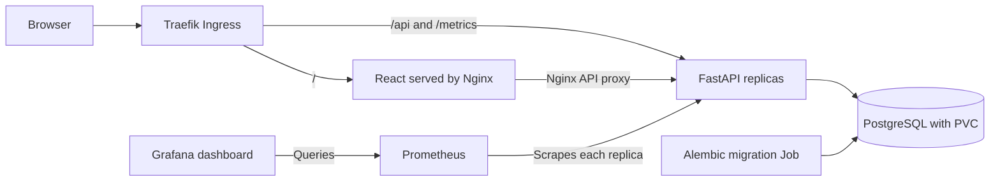
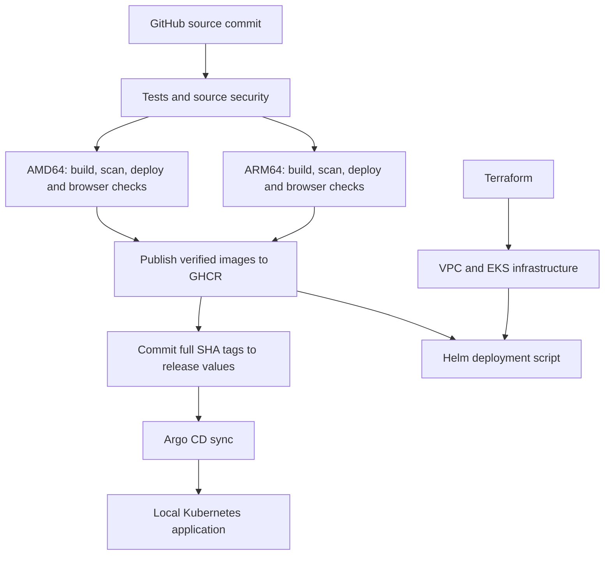
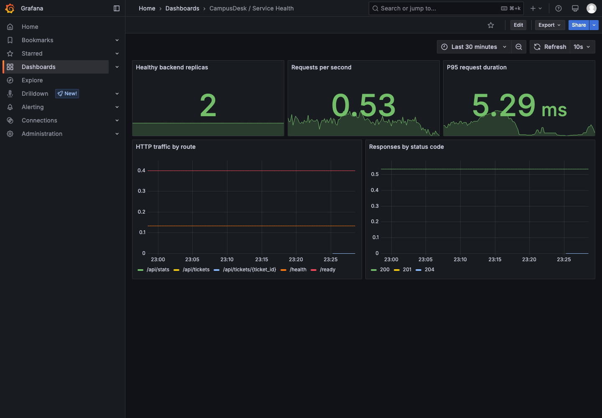
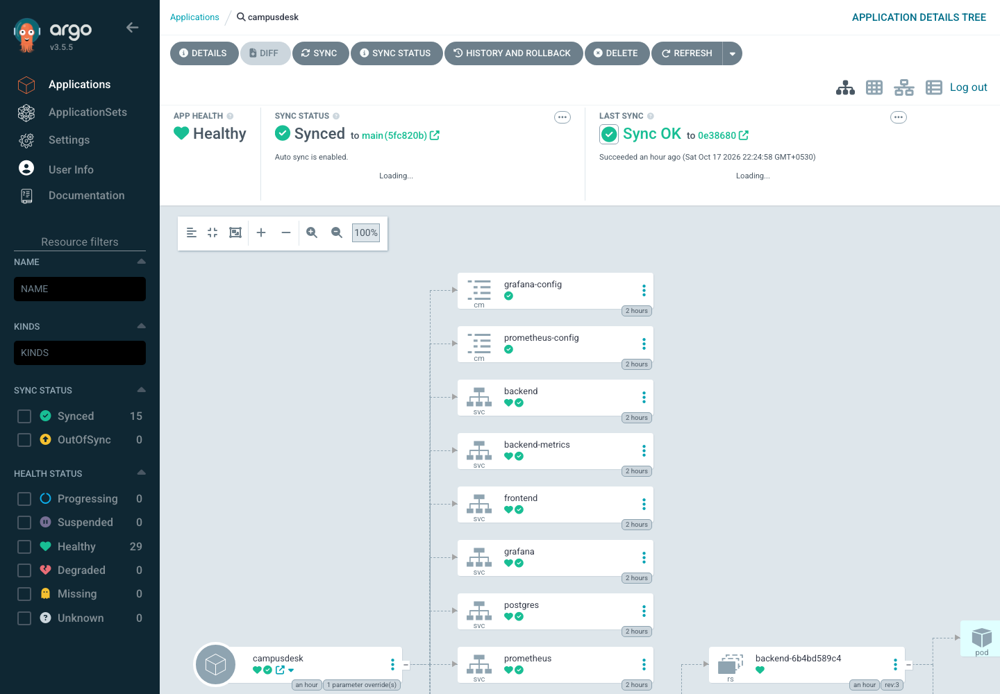

# CampusDesk — DevSecOps Capstone



**T. Abdul Kalam Azad · 24BCS10053**

CampusDesk is a campus IT helpdesk for reporting and managing network, hardware,
software and account-access issues. Students and staff create support tickets;
the support team assigns requests, sets priorities, tracks progress and resolves
issues through a responsive web interface.

This repository takes that application through the complete delivery lifecycle:
REST API and database, automated tests, containers, security gates, multi-platform
image publication, infrastructure as code, Kubernetes deployment, GitOps,
monitoring, troubleshooting and cloud cleanup. It preserves the original
CampusDesk project and its development history.

**Project status:** all ten technical modules have implementation and recorded
verification. The owner has confirmed that the course submission form has been
submitted. Technical results below refer to the **17 October 2026** verification;
the temporary AWS environment was destroyed after the demonstration.

| Start here | Deliverable |
|---|---|
| Review the requirements | [Final assignment audit](FINAL-AUDIT.md) and [submission checklist](SUBMISSION.md) |
| Run the application | [Docker Compose quick start](#docker-compose-quick-start) |
| Watch the demonstration | [Main walkthrough — 11 min 5 sec](demo/walkthrough.mp4), [video chapters](demo/README.md#main-video-chapters), [subtitles](demo/walkthrough.srt) |
| Inspect troubleshooting demonstrations | [Verification supplement — 1 min 55 sec](demo/verification-supplement.mp4), with on-screen explanations |
| View the presentation | [12-slide PDF](demo/slides.pdf) |
| Inspect test and deployment proof | [Dated evidence index](evidence/2026-10-17/README.md) and [final verification](evidence/2026-10-17/final-audit/README.md) |
| Inspect the successful application pipeline | [GitHub Actions run 39050953328](https://github.com/abdulkalamazad1001/campusdesk-devops-capstone/actions/runs/39050953328) |

### Verified results at a glance

| API tests | Browser checks | Image platforms | Observed scale-out |
|:---:|:---:|:---:|:---:|
| **40 passed** | **17 passed** | **AMD64 + ARM64** | **2 → 4 replicas** |

Results were recorded on 17 October 2026. Both application images passed the
HIGH/CRITICAL Trivy gate on each architecture before publication.



*The working application, captured through Kubernetes Ingress with synthetic support tickets.*

## Contents

- [Application features](#application-features)
- [Architecture](#architecture)
- [Engineering decisions](#engineering-decisions)
- [Technology stack](#technology-stack)
- [Repository structure](#repository-structure)
- [Where each requirement lives](#where-each-requirement-lives)
- [Prerequisites and environments](#prerequisites-and-environments)
- [Docker Compose quick start](#docker-compose-quick-start)
- [Configuration and secrets](#configuration-and-secrets)
- [API and data model](#api-and-data-model)
- [Tests and development](#tests-and-development)
- [Containers and persistence](#containers-and-persistence)
- [CI/CD and security](#cicd-and-security)
- [Local Kubernetes and Helm](#local-kubernetes-and-helm)
- [Argo CD and GitOps](#argo-cd-and-gitops)
- [AWS infrastructure](#aws-infrastructure)
- [Observability and autoscaling](#observability-and-autoscaling)
- [Troubleshooting and recovery](#troubleshooting-and-recovery)
- [Verification and evidence](#verification-and-evidence)
- [Presentation and video](#presentation-and-video)
- [Cleanup](#cleanup)
- [Known limits](#known-limits)
- [Sources and acknowledgements](#sources-and-acknowledgements)

## Application Features

- Create, inspect, edit and delete helpdesk tickets.
- Track tickets through `open`, `in_progress` and `resolved` states.
- Classify issues as network, hardware, software, access or other.
- Assign low, medium, high or urgent priority and a support assignee.
- Record the requester, campus location and a detailed issue description.
- Search ticket titles, requesters and locations; filter by status and paginate results.
- Display total tickets, status counts and unresolved urgent tickets.
- Validate inputs in the API and display request failures in the interface.
- Use the interface on desktop and narrow screens, with keyboard dismissal checks.
- Persist tickets in PostgreSQL across application container restarts.

Demonstration records are synthetic. The application does not implement student
login or role-based access control; its requester and assignee fields are descriptive
text, not authenticated identities.

## Architecture



A browser loads the React interface and sends JSON requests to `/api`. In Compose,
Nginx proxies those requests to FastAPI. In Kubernetes, Traefik routes `/api`
directly to the backend Service and other application paths to the frontend
Service. FastAPI validates requests, uses SQLAlchemy to access PostgreSQL and
returns JSON. Alembic owns database schema changes.

`/health` confirms the API process can respond. `/ready` additionally queries the
tickets table, so a missing database or unapplied migration prevents Kubernetes
from sending traffic to that backend. Each backend replica exposes its own
Prometheus counters and latency histogram.



The demonstrated GitOps target is local Kind. AWS deployment uses the same chart
with AWS values and the published images through an explicit deployment script.
The CI workflow validates Terraform but does not create AWS infrastructure.
Compose, Kind and EKS each have separate PostgreSQL storage; their data is not
synchronized automatically.

## Engineering Decisions

| Decision | Reason | Result in this implementation |
|---|---|---|
| Publish only after deployment checks | An image that builds can still fail at runtime | Each architecture must pass Trivy, Helm deployment, smoke and browser checks before publication |
| Publish the scanned image archives | Rebuilding after a scan could change the delivered artifact | The publish job loads the tested archives and assembles their multi-platform manifest |
| Separate liveness from readiness | A running process may be unable to serve database requests | `/health` checks the process; `/ready` checks database access and the migrated schema |
| Use migrations as an explicit deployment step | Schema changes need a repeatable order | Compose and Kubernetes run Alembic before the backend becomes ready |
| Scrape every backend replica | A load-balanced metrics URL can hide individual replica counters | A headless Service exposes per-replica targets to Prometheus |
| Keep deployment intent in Git | Manual changes are difficult to reproduce and can drift | CI promotes tested SHA tags; Argo CD reconciles the tracked values |
| Reproduce failures in separate resources | Troubleshooting should demonstrate diagnosis and recovery clearly | Disposable selector, image and readiness exercises preserve the main application |
| Verify teardown after the cloud demo | Kubernetes can create cloud dependencies outside Terraform's state | Pre-destroy cleanup and read-only AWS checks complement `terraform destroy` |

## Technology Stack

| Layer | Implementation and purpose |
|---|---|
| Frontend | React 19, Vite, Lucide icons and responsive CSS |
| API | Python 3.13, FastAPI, Pydantic validation and SQLAlchemy |
| Database | PostgreSQL 17; Alembic migration history |
| Tests | Pytest API tests, PostgreSQL integration in CI, Playwright browser checks |
| Code and dependency checks | Ruff, Bandit, pip-audit, npm audit and Gitleaks |
| Containers | Alpine-based Python backend; multi-stage React build and unprivileged Nginx |
| CI and registry | GitHub Actions, Trivy, GitHub Container Registry |
| Infrastructure | Terraform, AWS VPC, EKS managed nodes, IAM and EBS CSI |
| Kubernetes | Kind locally; Helm 3, Traefik, probes, persistent storage and HPA |
| GitOps | Argo CD tracking this repository's Helm chart and release values |
| Observability | Prometheus, Grafana, provisioned dashboard and alert rules |

CI pins Python 3.13, Node.js 24, Helm 3.17.4 and Terraform 1.11.4. Dependency
requirements and lockfiles are stored with their components. Image references and
chart versions are defined in the Dockerfiles, Helm values and deployment scripts.

## Repository Structure

```text
campusdesk-devops-capstone/
├── backend/
│   ├── app/                  FastAPI routes, validation, database and ticket model
│   ├── alembic/              Database migration environment and revisions
│   ├── tests/                Isolated API tests and database fixtures
│   └── Dockerfile            Non-root Python application image
├── frontend/                 React application, assets, Vite and Nginx configuration
├── .github/workflows/        CI tests, security, builds, registry publication
├── docker-compose.yml        Local database, migration, backend and frontend
├── .env.example              Local Compose configuration example
├── helm/campusdesk/           Application chart, values, templates and dashboard
├── k8s/                      Kind, namespace, ingress controller and AWS storage
├── gitops/                   Argo CD installation values and Application
├── terraform/                AWS infrastructure, variable example and cleanup scripts
├── monitoring/               Built-in and community-chart monitoring guides
├── security/                 Source security tools, policy and findings notes
├── troubleshooting/          Disposable failure demonstrations and repair instructions
├── scripts/                  Deployment, browser, evidence, load and security utilities
├── evidence/                 Timestamped reports, screenshots and verification records
├── demo/                     Final walkthrough, supplement, subtitles and slides
├── FINAL-AUDIT.md             Module-by-module verification and evidence map
└── SUBMISSION.md              Student details and submission deliverables
```

`evidence/local/` holds ignored working artifacts. Credentials, local environment
files, Terraform state and plans are excluded from Git. Historical shared exercise
material is separately credited in `evidence/shared-aws/`; it is not proof of the
CampusDesk AWS deployment.

## Where Each Requirement Lives

| Module | Implemented requirement | Source and evidence |
|---|---|---|
| M1 — Application | Original helpdesk, REST CRUD, database, migration, frontend | [API](backend/app/main.py), [migration](backend/alembic/versions/0001_tickets.py), [frontend](frontend/), [browser evidence](evidence/2026-10-17/browser-compose/) |
| M2 — Testing | 40 API tests and isolated database fixtures | [Tests](backend/tests/), [pytest verification](evidence/2026-10-17/final-audit/pytest.txt) |
| M3 — Git | Public repository, development history, ignore rules; owner confirms submission | [History evidence](evidence/2026-10-17/commit-history-output.png), [.gitignore](.gitignore), [submission record](SUBMISSION.md) |
| M4 — Docker | Non-root backend and frontend, multi-stage build, Compose | [Backend image](backend/Dockerfile), [frontend image](frontend/Dockerfile), [Compose](docker-compose.yml) |
| M5 — CI/CD | Automated checks and SHA-tagged GHCR publication | [Workflow](.github/workflows/campusdesk.yml), [successful run](https://github.com/abdulkalamazad1001/campusdesk-devops-capstone/actions/runs/39050953328) |
| M6 — DevSecOps | HIGH/CRITICAL Trivy gate on both images and architectures | [AMD64 reports](evidence/2026-10-17/ci-39050953328/trivy-reports-amd64/), [ARM64 reports](evidence/2026-10-17/ci-39050953328/trivy-reports-arm64/) |
| M7 — Terraform | Real VPC, subnets, EKS and managed nodes; verified teardown | [Terraform](terraform/), [AWS Console captures](evidence/2026-10-17/aws/), [cleanup verification](evidence/2026-10-17/final-audit/aws-cleanup.txt) |
| M8 — Kubernetes / Helm | Replicas, Services, Ingress, probes, PVC and Helm deployment | [Chart](helm/campusdesk/), [EKS deployment](evidence/2026-10-17/aws-helm-deploy.txt), [Helm release](evidence/2026-10-17/aws-helm-list.txt) |
| M9 — Observability | Metrics, per-replica scraping, dashboard and observed scaling | [Monitoring guide](monitoring/README.md), [screenshots](evidence/2026-10-17/final-audit/monitoring/), [HPA evidence](evidence/2026-10-17/autoscaling-output.png) |
| M10 — Presentation | Project documentation, 12 slides and narrated demonstration | [Slides](demo/slides.pdf), [walkthrough](demo/walkthrough.mp4), [supplement](demo/verification-supplement.mp4) |

[FINAL-AUDIT.md](FINAL-AUDIT.md) records the exact instructor reference revision
and the scope of each verified result.

## Prerequisites and Environments

Choose the environment needed for the task. AWS is not required to run or test the
application locally.

| Task | Required tools |
|---|---|
| Run Compose | Git and Docker with the Compose v2 plugin; Python 3 only for optional seeding |
| Run API tests | Python 3.13 and pip; PostgreSQL when explicitly running integration tests |
| Build frontend / browser checks | Node.js and npm; CI uses Node.js 24; Playwright Chromium |
| Run local Kubernetes | Docker, Kind, kubectl, Helm 3 and Python 3 |
| Run GitOps | The local Kubernetes stack and access to this GitHub repository and GHCR |
| Provision AWS | Terraform, AWS CLI with an authenticated identity, kubectl, Helm 3 and Python 3 |

On macOS, start Docker Desktop before running container or Kind commands.
Linux can use Docker Engine. Windows has PowerShell deployment scripts listed
below. Shell examples use Bash unless explicitly labeled PowerShell.

Clone the repository once, or open your existing checkout:

```bash
git clone https://github.com/abdulkalamazad1001/campusdesk-devops-capstone.git
cd campusdesk-devops-capstone
```

| Environment | Application | API documentation | Monitoring / GitOps |
|---|---|---|---|
| Compose | `http://localhost:3000` | `http://localhost:8000/docs` | API metrics on port 8000 |
| Local Kind | `http://campusdesk.localhost:8088` | Backend port-forward described below | Prometheus `:9090`, Grafana `:3001`, Argo CD `http://argocd.localhost:8088` |
| AWS EKS | Hostname printed by the deployment script | Backend port-forward | ClusterIP Services through port-forwarding |

These addresses become available after the corresponding deployment succeeds.
The recorded AWS hostname is historical because that environment has been removed.

## Docker Compose Quick Start

Run from the repository root:

```bash
# Optional: create local settings before the first database initialization.
cp .env.example .env
# Edit .env if you want to override POSTGRES_PASSWORD.

docker compose up --build -d
docker compose ps -a
curl --fail http://localhost:8000/ready
```

Open **<http://localhost:3000>** for the application and
**<http://localhost:8000/docs>** for interactive Swagger documentation.
The migration service should finish with exit code `0`; it is a one-shot task,
not a permanently running service.

Compose starts PostgreSQL, waits for its health check, runs `alembic upgrade head`,
starts the backend after migration succeeds and starts the frontend after backend
readiness succeeds. This avoids serving application requests before the schema exists.

Optionally insert synthetic demonstration records:

```bash
python3 scripts/seed.py
```

Useful checks:

```bash
docker compose logs --tail=80 migrate backend frontend
docker compose exec postgres psql -U campusdesk -d campusdesk -c '\dt'
docker compose exec postgres psql -U campusdesk -d campusdesk   -c 'SELECT id, title, status FROM tickets ORDER BY id;'
curl --fail http://localhost:8000/health
curl --fail http://localhost:8000/api/stats
```

PowerShell users can run the same Docker commands, use `Copy-Item .env.example .env`
in place of `cp`, `python` in place of `python3`, and `curl.exe` for the curl examples.

## Configuration and Secrets

| Setting | Used by | Purpose / default |
|---|---|---|
| `POSTGRES_PASSWORD` | Compose `.env` | Defaults to `campusdesk-local-only`, intended for the local demonstration |
| `DATABASE_URL` | Backend and Alembic | Required connection URL; Compose and Kubernetes inject it |
| `TEST_DATABASE_URL` | Pytest | Optional isolated PostgreSQL URL; otherwise tests use in-memory SQLite |
| `APP_URL` | Browser verification | Target application URL; use the Kind address to test Ingress |
| `EVIDENCE_DIR` | Browser and capture scripts | Output directory for generated verification artifacts |
| `backend.repository`, `backend.tag` | Helm | Backend image; latest verified tag comes from release values |
| `frontend.repository`, `frontend.tag` | Helm | Frontend image; latest verified tag comes from release values |
| `database.storageClass` | Helm | Local default provisioner or `gp3` on AWS |
| `secrets.create` | Helm | Whether Helm creates credentials; disabled when scripts manage them |
| `ingress.host`, `ingress.tlsSecret` | Helm | Routing hostname and optional existing TLS Secret |
| `monitoring.enabled` | Helm | Enable the built-in Prometheus and Grafana stack |
| `autoscaling.*` | Helm | Backend minimum, maximum and CPU utilization target |

Compose interpolates the database password into its URL. For an override, use a
long random alphanumeric value; URL delimiters or separately URL-encoding the
shared value can make the database password differ from the parsed URL password.
Changing `.env` after PostgreSQL has initialized does not change its existing user
password. Keep existing database credentials or rotate them in PostgreSQL as well.

The Kubernetes scripts generate random database and Grafana credentials in memory
and preserve existing Secrets. The database Secret includes `POSTGRES_USER`,
`POSTGRES_DB`, `POSTGRES_PASSWORD` and `DATABASE_URL`. Argo CD renders Helm without
live Secret lookup, so its values use `secrets.create=false` and reuse the
externally created Secrets.

Use the normal AWS CLI authentication mechanism for cloud commands. Never add
credentials, tokens, `.env`, Terraform state, plan files or private recordings to
commits. Do not delete database Secrets while retaining a volume whose credentials
you still need.

## API and Data Model

### Routes

| Method | Route | Result |
|---|---|---|
| GET | `/api/tickets` | Ticket array, newest first; optional `status`, `q`, `limit`, `offset` |
| GET | `/api/tickets/{ticket_id}` | One ticket, or 404 |
| POST | `/api/tickets` | Create a validated ticket; 201 |
| PUT | `/api/tickets/{ticket_id}` | Replace editable ticket values; 200 |
| DELETE | `/api/tickets/{ticket_id}` | Delete a ticket; 204 with no response body |
| GET | `/api/stats` | Total, open, in-progress, resolved and unresolved urgent counts |
| GET | `/health` | Process liveness |
| GET | `/ready` | Database and schema readiness; 503 when unavailable |
| GET | `/metrics` | Prometheus text exposition |
| GET | `/docs` | Swagger UI on the backend port |
| GET | `/openapi.json` | Generated OpenAPI specification |

The list endpoint defaults to `limit=100`, accepts limits from 1 to 100, and
supports nonnegative offsets. Search is case-insensitive across title, requester
and location. SQL wildcard characters are escaped so user input is treated as
literal search text. The stats endpoint describes the whole ticket collection.

### Ticket fields

| Field | Validation / meaning |
|---|---|
| `title` | Required; 3–120 characters |
| `description` | Up to 4,000 characters; defaults to an empty string |
| `category` | `network`, `hardware`, `software`, `access`, `other`; default `other` |
| `priority` | `low`, `medium`, `high`, `urgent`; default `medium` |
| `status` | `open`, `in_progress`, `resolved`; default `open` |
| `requester` | Required; 2–80 characters |
| `location` | Required; 2–80 characters |
| `assignee` | 2–80 characters; default `Unassigned` |
| `id` | Database-generated integer identifier |
| `created_at`, `updated_at` | Server-managed timestamps |

Text is stripped of surrounding whitespace. Unknown input fields and NUL characters
are rejected. IDs must fit a positive PostgreSQL 32-bit integer. Validation failures
return 422. Failed database writes are rolled back and return 503; missing tickets
return 404. PUT accepts the same input schema as POST, so send all intended values
rather than treating it as a partial PATCH.

### Try the API

Create a synthetic ticket:

```bash
curl --fail-with-body -X POST http://localhost:8000/api/tickets   -H 'Content-Type: application/json'   -d '{"title":"Library Wi-Fi disconnects","description":"Synthetic demo request","category":"network","priority":"high","status":"open","requester":"Demo Student","location":"Central Library","assignee":"IT Support"}'
```

Search without manually encoding spaces:

```bash
curl --get --fail http://localhost:8000/api/tickets   --data-urlencode 'status=open' --data-urlencode 'q=Library'   --data-urlencode 'limit=10' --data-urlencode 'offset=0'
```

Copy the newly created ticket's `id`, then update or remove that demonstration
record in Swagger. Do not use an arbitrary existing ID when practicing deletion.

The schema is defined in [the ticket model](backend/app/models.py) and created by
[the initial Alembic migration](backend/alembic/versions/0001_tickets.py). A normal
startup uses migrations rather than silently creating tables from ORM models.

## Tests and Development

### API tests and lint

From the repository root on macOS / Linux:

```bash
python3.13 -m venv .venv
.venv/bin/python -m pip install -r backend/requirements-dev.txt
(cd backend && ../.venv/bin/python -m pytest -v)
(cd backend && ../.venv/bin/python -m ruff check .)
```

Windows PowerShell:

```powershell
python -m venv .venv
.venv/Scripts/python -m pip install -r backend/requirements-dev.txt
Push-Location backend
../.venv/Scripts/python -m pytest -v
../.venv/Scripts/python -m ruff check .
Pop-Location
```

The 40 API tests cover CRUD, filters, counts, pagination, literal wildcard search,
invalid inputs, identifier bounds, missing tickets, database write failures and
readiness failure. Tests apply the real Alembic migration. Each test uses a
rolled-back transaction. Local tests default to isolated in-memory SQLite;
CI supplies a dedicated PostgreSQL service through `TEST_DATABASE_URL`.

For PostgreSQL integration testing, use a separate disposable test database.
The suite refuses a test URL equal to the application's `DATABASE_URL`, but you
must still supply the correct isolated database. CI also verifies upgrade,
`alembic check` against the models, and downgrade to the base revision.

### Frontend and browser checks

```bash
npm --prefix frontend ci
npm --prefix frontend run build
node frontend/node_modules/playwright/cli.js install chromium
APP_URL=http://campusdesk.localhost:8088   EVIDENCE_DIR=evidence/local/browser-review node scripts/browser-check.mjs
```

Deploy the target environment before running browser checks. The recorded suite
passed 17 checks, including actual CRUD, validation, responsive layout and keyboard
interaction. Failure, pagination and empty-state boundary cases use browser mocks
and are identified as such in the results. The test creates and removes its own
uniquely named ticket; seed records are unnecessary.

For Compose, use `APP_URL=http://localhost:3000`. In PowerShell, set environment
variables with `$env:APP_URL='http://localhost:3000'` before running the Node command.

### Edit locally

For frontend development, keep the Compose backend running and start Vite:

```bash
npm --prefix frontend run dev
```

Use the URL printed by Vite, normally `http://localhost:5173`. Its `/api` proxy
points to `http://127.0.0.1:8000`.

For backend development, either rebuild the Compose backend after edits or run
Uvicorn against a separately reachable development PostgreSQL database:

```bash
# Set DATABASE_URL to your development database before these commands.
cd backend
../.venv/bin/alembic upgrade head
../.venv/bin/uvicorn app.main:app --reload --host 127.0.0.1 --port 8000
```

The Compose database does not publish port 5432 to the host. Its `postgres`
hostname is reachable inside the Compose network, so it cannot be copied directly
into a host-run Uvicorn connection URL. Also stop the Compose backend before binding
a host development server to the same port 8000.

## Containers and Persistence

| Component | Container design | Runtime |
|---|---|---|
| Backend | Python 3.13 Alpine; dependencies installed during build; pip removed afterwards | UID 10001, port 8000 |
| Frontend | Node.js 24 build stage; only built static assets copied into unprivileged Nginx | UID 101, port 8080 |
| PostgreSQL | PostgreSQL 17 Alpine with persistent data volume | Internal database service |
| Migration | Reuses the backend image and executes `alembic upgrade head` | One-shot Compose service / Kubernetes Job |

The frontend runtime does not include the Node development server. Nginx serves
static files, handles client-side navigation, proxies API requests and provides
`/healthz`. Application ports in Compose bind to `127.0.0.1`.

Compose stores database files in the named `postgres-data` volume. Kubernetes
uses a PostgreSQL StatefulSet and PVC, with a default 2 GiB request. AWS uses the
`gp3` StorageClass and EBS CSI driver. Replacing an application pod preserves ticket
data; deleting its database volume does not. Backups and automatic cross-environment
replication are not implemented.

## CI/CD And Security

The workflow is [`.github/workflows/campusdesk.yml`](.github/workflows/campusdesk.yml).
It runs for pushes to `main`, pull requests and manual dispatches. Pull requests
run validation without publishing packages or changing release values.

| Stage | Checks and output | Release behavior |
|---|---|---|
| `test` | Ruff, 40 PostgreSQL-backed API tests, migration round-trip, promotion helper tests, frontend build, Helm lint/render, Terraform format/validation | Must pass before image jobs |
| `source-security` | Bandit, pip-audit, npm audit, Gitleaks and security helper checks | Must pass before image jobs |
| `build-scan-deploy` — AMD64 | Build both images, Trivy scan, deploy to ephemeral Kind, smoke and browser checks | Saves the scanned image archives after success |
| `build-scan-deploy` — ARM64 | Same checks natively on ARM64 | Supports Apple Silicon alongside AMD64 AWS workers |
| `publish` | Loads verified archives, pushes both architectures, creates full-SHA manifests, promotes release values | Main branch only; the sole job with repository/package write permissions |

Publication waits for both architectures. The publish job uses the same images
that passed scanning and deployment checks; it does not rebuild a different image
after validation. Main-branch runs are not cancelled midway, and the promotion
helper guards against an older run overwriting a newer release.

Image names:

```text
ghcr.io/abdulkalamazad1001/campusdesk-capstone-backend:<full-commit-sha>
ghcr.io/abdulkalamazad1001/campusdesk-capstone-frontend:<full-commit-sha>
```

Verified application release:

```text
f9bdd3af7bae550b433845272db006b7a08e34e2
```

Both packages were verified publicly
pullable for AMD64 and ARM64. [Release values](helm/campusdesk/values-release.json)
are the source of truth for promoted tags; base chart defaults can lag behind.
Full-SHA tagging connects each image to its source revision; the registry evidence
also records manifest digests.

GitOps promotion commits use `[skip ci]` to prevent a rebuild loop. Documentation
and evidence-only updates can use the same marker while preserving the tested
application release. Reports are uploaded as workflow artifacts and important
submission copies are retained in the dated evidence directory.

### Trivy Result Explained

Trivy scans each built image for known CVEs in its operating-system packages
(Alpine `apk`) and application libraries (Python wheels; the frontend runtime is
Nginx serving static files). The first Debian-based backend image failed the gate
with 48 findings, including **CVE-2025-47273** (HIGH): a path-traversal flaw in old
setuptools' package-index code that could let a crafted package name write files
outside the intended directory. The fix was to rebuild on a patched Alpine base and
remove pip/setuptools after installing dependencies, since the running service never
installs packages. Both application images recorded **0 HIGH/CRITICAL** findings in the
verified run: Trivy detected no matching findings at those severities using its
vulnerability database at scan time. It does not prove the application logic is secure,
and new CVEs can appear later, which is why every build rescans.
See [the original report](evidence/trivy-backend-initial.json) and
[the resolution notes](evidence/README.md#security-findings-and-resolution).

Test and scan reports are uploaded as workflow artifacts. There is no `continue-on-error`
on quality/security gates and no fabricated successful scan output. A failed scan must
be resolved before release. Trivy covers installed OS and application packages; it
does not establish that application authorization or business logic is secure.
See [security scopes, thresholds and local commands](security/README.md). The
linked successful run includes every configured source-security gate; the dated
evidence index retains the reports.


Additional security measures include non-root application containers, dropped
Linux capabilities, disabled privilege escalation and disabled automatic service
account token mounts for application pods. EKS API access is restricted to configured
trusted CIDRs. The [security guide](security/README.md) documents scan scopes,
thresholds and local reproduction commands.

## Local Kubernetes and Helm

Install Docker, Kind, kubectl, Helm 3 and Python 3 first. On macOS, the Helm 3
binary may need its Homebrew path explicitly selected:

```bash
brew install kind kubectl helm@3
export PATH="$(brew --prefix helm@3)/bin:$PATH"
bash scripts/local-k8s.sh
```

Linux uses the same script with those tools on `PATH`. Windows PowerShell:

```powershell
powershell -ExecutionPolicy Bypass -File scripts/local-k8s.ps1
```

The bootstrap creates the dedicated `campusdesk` Kind cluster if needed, builds
and loads local application images, creates credentials, installs Traefik and
Metrics Server, and installs the application chart. Commands explicitly target
`kind-campusdesk`. The script refuses to overwrite an application already owned
by Argo CD; use GitOps for subsequent changes in that environment.

```bash
kubectl --context kind-campusdesk -n campusdesk get pods,svc,ingress,hpa,pvc
helm --kube-context kind-campusdesk list -n campusdesk
kubectl --context kind-campusdesk -n campusdesk rollout status deployment/backend
kubectl --context kind-campusdesk -n campusdesk rollout status deployment/frontend
python3 scripts/seed.py --url http://campusdesk.localhost:8088
```

### Chart behavior

- Backend and frontend each start with at least two replicas behind ClusterIP Services.
- Backend HPA scales from 2 to 4 replicas at a 70% CPU target.
- Application containers request 100m CPU / 128 MiB RAM and limit 500m / 256 MiB.
- Backend startup/liveness use `/health`; readiness uses `/ready`.
- Frontend probes use Nginx `/healthz`.
- A migration Job prepares PostgreSQL; backend init containers wait for the schema.
- A StatefulSet and PVC persist PostgreSQL data.
- Traefik routes the configured hostname to frontend and backend Services.
- A headless `backend-metrics` Service discovers all backend replicas for scraping.

| Values file | Purpose |
|---|---|
| [`values.yaml`](helm/campusdesk/values.yaml) | Common chart settings and defaults |
| [`values-local.yaml`](helm/campusdesk/values-local.yaml) | Local image names, externally managed Secrets and monitoring NodePorts |
| [`values-aws.yaml`](helm/campusdesk/values-aws.yaml) | EBS `gp3`, externally managed Secrets and internal monitoring Services |
| [`values-release.json`](helm/campusdesk/values-release.json) | Promoted GHCR repositories and verified source SHA tags |

Later values files override earlier ones. Argo CD combines the local values and
release values, while the AWS deploy script combines AWS values and release values.
The initial local Helm bootstrap deliberately uses locally built images.

Swagger is available on the backend port, rather than a `/docs` Ingress rule:

```bash
kubectl --context kind-campusdesk -n campusdesk port-forward svc/backend 8001:8000
# While this runs, open http://localhost:8001/docs in a browser.
```

## Argo CD and GitOps

After local Helm bootstrap, transfer application deployment ownership to Argo CD:

```bash
bash scripts/local-gitops.sh
```

Windows:

```powershell
powershell -ExecutionPolicy Bypass -File scripts/local-gitops.ps1
```

The scripts install the pinned Argo CD chart, apply its Ingress and the
[CampusDesk Application](gitops/application.yaml), then wait for Synced/Healthy.
Open **<http://argocd.localhost:8088>**. The initial admin password is stored in
`argocd-initial-admin-secret` in namespace `argocd`; retrieve it privately and keep
it out of screenshots and Git.

```bash
kubectl --context kind-campusdesk -n argocd get application campusdesk
kubectl --context kind-campusdesk -n campusdesk get deployments
```

The Application tracks `main`, combines local networking with promoted GHCR tags,
and enables automated sync and self-healing. Automatic pruning is disabled.
Differences in backend replica count managed by the HPA are handled by the
Application configuration.

Use one deployment owner at a time. After adoption, change the tracked configuration
in Git. Argo CD uses Helm to render templates; its syncs do not create new Helm
release-history entries. The bootstrap release can still appear in `helm list`.
Running a separate `helm upgrade` against those same managed objects can cause
conflicting changes.

For a GitOps rollback, commit a previously verified image SHA in the release values
and let Argo CD reconcile. An application rollback does not automatically undo a
database migration; schema compatibility must be considered separately.

## AWS Infrastructure

The [Terraform runbook](terraform/README.md) contains the detailed deployment and
cleanup procedure. The completed capstone used region `ap-south-1` and cluster
`campusdesk-24bcs10053`.

| Resource | Configuration in this project |
|---|---|
| VPC | `10.42.0.0/16` across two availability zones |
| Public subnets | `10.42.1.0/24`, `10.42.2.0/24` |
| Private subnets | `10.42.11.0/24`, `10.42.12.0/24` |
| Connectivity | Internet gateway, one NAT gateway, subnet routing and load-balancer tags |
| EKS | Kubernetes 1.35 configured; private endpoint plus CIDR-restricted public API |
| Managed nodes | Two desired `t3.medium` workers in private subnets; bounds 1–3 |
| Storage | EBS CSI add-on with IAM role; application PVC uses `gp3` |
| Logging | EKS API, audit and authenticator logs |
| Application exposure | Traefik LoadBalancer Service creates an AWS Network Load Balancer |

The node group's size bounds do not themselves install a node autoscaler. The
application's HPA scales backend pods, not EC2 instances. The single NAT gateway
and single PostgreSQL instance are deliberate demonstration simplifications.

### Provision and deploy

This section creates billable AWS resources. Authenticate the intended AWS CLI
identity and review the plan before applying. Confirm supported EKS versions and
account quotas before a future deployment; the recorded version reflects this run.

From the repository root:

```bash
aws sts get-caller-identity
cp terraform/terraform.tfvars.example terraform/terraform.tfvars
# Edit terraform.tfvars: replace the example CIDR with your trusted public IPv4 /32.
terraform -chdir=terraform init
terraform -chdir=terraform fmt -check
terraform -chdir=terraform validate
terraform -chdir=terraform plan -out=campusdesk.tfplan
terraform -chdir=terraform apply campusdesk.tfplan
bash scripts/aws-k8s.sh
```

The deploy script reads cluster and region outputs, configures an explicit kubectl
context, waits for workers, creates Secrets in memory, installs storage, Traefik
and Metrics Server, and deploys the chart with the verified release values.
It prints the application load-balancer hostname. Allow time for its DNS record
to become available.

```bash
kubectl --context campusdesk-24bcs10053 get nodes
kubectl --context campusdesk-24bcs10053 -n campusdesk get pods,svc,ingress,hpa,pvc
helm --kube-context campusdesk-24bcs10053 list -n campusdesk
terraform -chdir=terraform plan
```

Change the example context if you customized `cluster_name`. EKS API calls must
come from an allowed public CIDR and an authorized AWS identity. Preserve Terraform
state until deployment and cleanup verification are complete.

### Recorded AWS outcome

The project has genuine plan, apply, no-drift, Console, node, workload, browser and
cleanup evidence. Terraform destroyed **61 resources** after recording. Subsequent
read-only checks found no active project EKS cluster, VPC, workers, NAT gateways,
load balancers or application volumes in the checked scope. The KMS key was
scheduled for deletion on **16 November 2026**.

See [AWS screenshots](evidence/2026-10-17/aws/),
[destroy output](evidence/2026-10-17/terraform-destroy-output.png) and
[cleanup checks](evidence/2026-10-17/final-audit/aws-cleanup.txt).

## Observability and Autoscaling

The built-in monitoring stack is enabled in the demonstrated local deployment.
Prometheus discovers backend pod addresses through the headless Service and scrapes
each replica every 15 seconds. This avoids treating one load-balanced response as
the metric history of every backend.

| Signal | Meaning |
|---|---|
| `campusdesk_http_requests_total` | Request counter labeled by method, route template and status |
| `campusdesk_http_request_duration_seconds` | Request-duration histogram labeled by method and route |
| `up{job="campusdesk"}` | Whether each backend scrape target is reachable |
| Grafana service health dashboard | Healthy targets, request rate, p95 latency, routes and status codes |

Route-template labels such as `/api/tickets/{ticket_id}` keep time-series counts
bounded. `/metrics` scrapes are excluded from the application request counter.

Local interfaces:

- Prometheus targets: <http://localhost:9090/targets>
- Grafana dashboard: <http://localhost:3001/d/campusdesk>
- Application metrics through Ingress: <http://campusdesk.localhost:8088/metrics>

Grafana's username is `admin`. Retrieve its generated password privately:

```bash
kubectl --context kind-campusdesk -n campusdesk get secret campusdesk-grafana   -o jsonpath='{.data.password}' | base64 --decode
```

PowerShell users can use `powershell -File scripts/grafana-password.ps1`.
The dashboard and Prometheus data source are provisioned automatically from Git.

Useful PromQL expressions:

```promql
sum(up{job="campusdesk"})
sum(rate(campusdesk_http_requests_total[5m]))
histogram_quantile(0.95, sum by (le) (rate(campusdesk_http_request_duration_seconds_bucket[5m])))
```

Alert rules cover an unavailable backend for two minutes and an HTTP 5xx ratio
over 5% for five minutes. No external notification destination is configured.
Prometheus and Grafana history use ephemeral storage in this demonstration;
redeployment restores configuration but not previous metric history.

Generate application traffic and inspect HPA behavior:

```bash
python3 scripts/load.py --url http://campusdesk.localhost:8088 --seconds 60 --workers 4
kubectl --context kind-campusdesk -n campusdesk get hpa
kubectl --context kind-campusdesk -n campusdesk top pods
```

The recorded load exercise completed **31,274 successful requests** with zero
failures and observed the backend scale from **2 to 4 replicas**. Light traffic
may not cause scaling, and the HPA needs Metrics Server to report utilization.
See the [load transcript](evidence/2026-10-17/load.txt) and
[scale-out evidence](evidence/2026-10-17/autoscaling-output.png).

<details>
<summary><strong>View the recorded Grafana and Argo CD dashboards</strong></summary>



*Provisioned service health dashboard with traffic, latency and healthy targets.*



*Recorded reconciliation of the CampusDesk application.*

</details>

The repository also provides a community-chart alternative using Prometheus and
Grafana charts in namespace `monitoring`. Installation, values and port-forward
commands are in [monitoring/README.md](monitoring/README.md). The built-in stack
and community stack have different values and access ports; follow the selected
option's instructions.

## Troubleshooting and Recovery

Start with status, recent events and logs; then inspect the failing component.

```bash
docker compose ps -a
docker compose logs --tail=100 migrate backend postgres
kubectl --context kind-campusdesk -n campusdesk get pods,svc,ingress,pvc
kubectl --context kind-campusdesk -n campusdesk get events --sort-by=.lastTimestamp
kubectl --context kind-campusdesk -n campusdesk logs deployment/backend --tail=100
```

| Symptom | Inspect | Typical correction |
|---|---|---|
| Compose backend does not start | PostgreSQL health and migration exit code | Correct database configuration, then rerun the failed migration/startup |
| API returns 503 from `/ready` | Database connectivity, credentials, migration logs | Restore the database and schema; keep `/ready` as the readiness probe |
| Pod is Running but not Ready | Probe path, port and pod events | Correct the probe or its dependency; liveness and readiness serve different purposes |
| `ImagePullBackOff` | Exact pod pull error, image tag, package visibility, architecture | Use the verified full-SHA image; fix authentication or registry connectivity as indicated |
| Service has no ready endpoints | Selectors, pod labels and readiness | Match selector to actual labels and resolve readiness failures |
| Ingress returns 404 | Request hostname, Ingress rules and Traefik | Use the configured hostname and correct port |
| HPA reports unknown metrics | Metrics Server status and pod resource requests | Restore CPU metrics before diagnosing scale-out behavior |
| Grafana panels are empty | Prometheus targets, data source and recent traffic | Restore successful scrapes and generate requests; allow a rate window to accumulate |
| Argo CD reverses a manual edit | Application owner and tracked Git values | Commit the intended change to Git |
| EKS API times out | Current public IP and `api_allowed_cidrs` | Update the trusted CIDR and apply the reviewed Terraform change |
| Terraform destroy has dependency errors | Kubernetes load balancers, volumes and ENIs in the project VPC | Run pre-destroy cleanup and inspect remaining project dependencies |

If `campusdesk.localhost` does not resolve, verify routing with an explicit Host
header:

```bash
curl --fail -H 'Host: campusdesk.localhost' http://127.0.0.1:8088/api/tickets
```

The [troubleshooting guide](troubleshooting/README.md) gives reproducible exercises
for a nonexistent image, incorrect Service selector and failed readiness probe.
These use disposable demo resources and include their cleanup. The
[verification supplement](demo/verification-supplement.mp4) records actual image-pull
and selector failures followed by repair and successful recovery.

For a Helm-managed environment, inspect `helm history` before choosing a rollback
revision. For an Argo-managed environment, revert the intended Git configuration.
Neither operation automatically reverses database migrations or restores deleted data.

## Verification and Evidence

Recorded on **17 October 2026**:

| Check | Recorded result | Evidence |
|---|---|---|
| API tests | 40 passed | [Pytest](evidence/2026-10-17/final-audit/pytest.txt) |
| Browser regression | 17 passed against local Kind | [Browser results](evidence/2026-10-17/final-audit/browser-kind/browser-results.json) |
| Code / frontend | Ruff and production build passed | [Lint](evidence/2026-10-17/final-audit/lint.txt), [build](evidence/2026-10-17/final-audit/frontend-build.txt) |
| Configuration | Helm lint and Terraform validation passed | [Helm](evidence/2026-10-17/final-audit/helm-lint.txt), [Terraform](evidence/2026-10-17/final-audit/terraform-validate.txt) |
| Application CI | All five jobs succeeded | [Pipeline](https://github.com/abdulkalamazad1001/campusdesk-devops-capstone/actions/runs/39050953328) |
| Image security | Zero HIGH/CRITICAL findings in both images on both architectures at scan time | [CI artifacts retained in Git](evidence/2026-10-17/ci-39050953328/) |
| Registry | Public AMD64 and ARM64 manifests verified | [Registry check](evidence/2026-10-17/final-audit/registry.txt) |
| Secret scan | No leaks detected in the 47-commit history examined by that scan | [Gitleaks](evidence/2026-10-17/final-audit/full-history-secrets.txt) |
| Local deployment | Argo Synced/Healthy; two available replicas per application tier | [Release health](evidence/2026-10-17/final-audit/release-health.txt) |
| Monitoring | Two UP backend targets and populated dashboard | [Screenshots](evidence/2026-10-17/final-audit/monitoring/) |
| AWS teardown | No active project resources in the checked scope; KMS pending deletion | [Cleanup](evidence/2026-10-17/final-audit/aws-cleanup.txt) |

Evidence is a dated record, not a claim that a removed cloud environment remains
online. The application source release is distinguished from later documentation
and presentation commits. Earlier package screenshots can show an earlier release;
the final registry check verifies the promoted SHA. Historical and mocked cases
are identified in the [evidence notes](evidence/2026-10-17/README.md).

Reproduce relevant checks with the normal test commands above. Evidence utilities
include `scripts/run-evidence.py` for timestamped command output,
`scripts/browser-check.mjs` for browser results and screenshots, and
`scripts/capture-monitoring.mjs` for monitoring captures. Store new local output
under `evidence/local/` until it has been reviewed for publication.

## Presentation and Video

| Artifact | Contents |
|---|---|
| [Main walkthrough](demo/walkthrough.mp4) | 11 min 5 sec, 720p, recorded narration, slides followed by real project screenshots and demonstrations |
| [Verification supplement](demo/verification-supplement.mp4) | 1 min 55 sec, silent with on-screen explanations; Swagger, database, non-root containers, registry, Helm and failure recovery |
| [Slides](demo/slides.pdf) | 12-slide project presentation |
| [Video chapters](demo/README.md#main-video-chapters) | Navigation through the final main video |
| [Subtitles](demo/walkthrough.srt) | English caption file for the main video |
| [Video notes](demo/README.md) | Recording sources, editing details and deliverable information |

The main walkthrough covers the application, source, tests, commit/push and CI,
security, Terraform, AWS Console, EKS, Argo CD, monitoring and cleanup. The
supplement provides additional database and troubleshooting demonstrations. If
GitHub does not preview an MP4, download the file and play it locally.

The course submission has been completed according to the owner's confirmation.
[SUBMISSION.md](SUBMISSION.md) keeps the repository and deliverables together;
this documentation does not claim an independently verified form receipt or grade.

## Cleanup

### Local Compose

```bash
docker compose down
```

This stops the stack and preserves the database volume. Use
`docker compose down -v` only when you intentionally want to delete its local data.

### Local Kind

```bash
kind delete cluster --name campusdesk
```

This removes the dedicated local cluster and its cluster-local application data.
Export anything you need before deleting it. The completed project retained Kind
for local demonstration; deletion is an optional teardown step.

### AWS

Run the pre-destroy script while the cluster still exists, so Kubernetes can
remove its load balancers and volumes before Terraform removes the infrastructure:

```bash
cd terraform
bash scripts/pre-destroy.sh
terraform destroy
```

For PowerShell, use `powershell -ExecutionPolicy Bypass -File scripts/pre-destroy.ps1`
in the Terraform directory, followed by `terraform destroy`.

The pre-destroy script targets the dedicated project cluster, removes its application
and ingress releases, deletes application PVCs and LoadBalancer Services, and waits
for cloud dependencies. Confirm that you have backed up any data you intend to keep.
After Terraform finishes, check the project VPC, EKS, instances, NAT gateways,
Elastic IPs, load balancers, volumes and network interfaces. Retain the state and
cleanup records until those checks are complete. The full procedure and dependency
recovery notes are in [terraform/README.md](terraform/README.md).

## Known Limits

- No authentication or application RBAC: use synthetic data in the demonstration.
- Plain HTTP Ingress in the demonstrated configuration; public production use needs TLS and appropriate access controls.
- PostgreSQL is a single instance without a configured backup and recovery system.
- Two application replicas improve availability but do not make the single database highly available.
- Monitoring storage is ephemeral, with no external alert delivery configured.
- AWS uses one NAT gateway and has been destroyed after evidence capture.
- Security reports describe the packages and vulnerability database at scan time; later vulnerabilities require rescanning.
- Community monitoring charts are an alternative deployment path; the demonstrated Argo application uses the built-in stack.
- GitOps recovery requires schema-compatible releases and preserved database credentials.

## Sources and Acknowledgements

- [Instructor's project brief](https://github.com/Nency-Ravaliya/devsecops-python/blob/main/README.md)
- [Grading rubric](https://github.com/Nency-Ravaliya/devsecops-python/blob/main/GRADING.md)
- [Submission instructions](https://github.com/Nency-Ravaliya/devsecops-python/blob/main/SUBMISSION.md)
- The exact assignment revision reviewed is recorded in [FINAL-AUDIT.md](FINAL-AUDIT.md).
- DM Sans is bundled locally under its [SIL Open Font License](frontend/public/fonts/OFL.txt); the interface does not need an external font service.
- The campus photograph uses [this Unsplash source image](https://images.unsplash.com/photo-1523240795612-9a054b0db644) as illustrative imagery.
